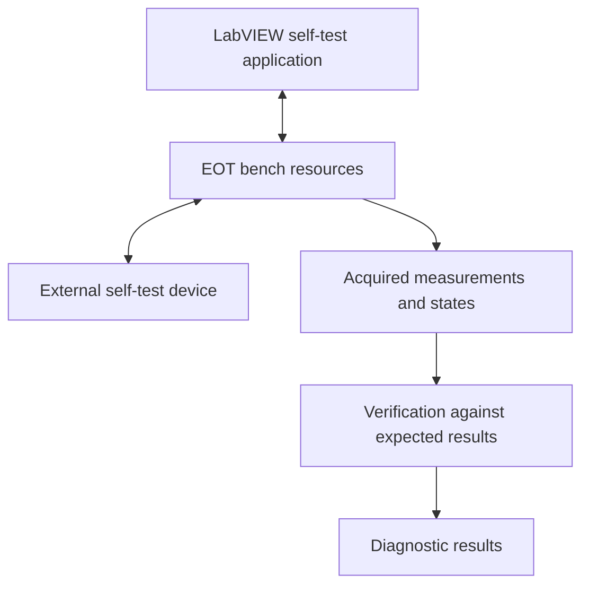

# EOT Bench Self-Test System

**Test bench diagnostics | LabVIEW | Hardware verification**

> An engineering  project completed in an industrial setting. This repository presents the approach and outcomes; proprietary schematics, production software, and customer data are not published.

## Overview

This project consists of developing an external self-test device and a LabVIEW application to verify the resources of a generic EOT test bench before product testing.

The system checks the bench’s digital inputs and outputs, relays, fixed power supplies, and multimeter measurement lines. Its purpose is to help distinguish bench faults from product faults and support troubleshooting.

## Engineering challenge

A product test failure can originate from the product itself or from the test bench. Identifying the source requires checking that the bench resources operate correctly.

Key objectives:

- Develop a dedicated hardware device for checking bench resources.
- Automate verification through a LabVIEW application.
- Verify digital I/O, relay switching, power supplies, and measurement paths.
- Present diagnostic results to support maintenance and troubleshooting.

## System architecture

## Hardware implementation

The external self-test device connects to the EOT bench and provides the electrical paths required to verify its resources.

The hardware and LabVIEW application work together to stimulate outputs, acquire input states, and check measurement paths.

## Verification coverage

| Resource | Verification |
| --- | --- |
| Digital outputs | Check commanded output states through the self-test connections. |
| Digital inputs | Verify that applied states are correctly acquired. |
| Relays | Check switching operation and associated electrical paths. |
| Fixed power supplies | Verify the 24 V, 12 V, and 5 V supplies. |
| Multimeter lines | Check the measurement paths used by the bench. |
| Continuity paths | Verify continuity through the relevant self-test connections. |

## LabVIEW application

The LabVIEW application coordinates the verification sequence, communicates with the bench resources, and evaluates the acquired measurements and digital states.

The results help identify which resource or electrical path requires further investigation.

## Operating workflow

1. Connect the external self-test device to the EOT bench.
2. Launch the LabVIEW self-test application.
3. Run the verification sequence.
4. Review the diagnostic results.
5. Investigate any detected faults before product testing.

## Outcome

- Developed an external device for verifying EOT bench resources.
- Implemented automated verification using LabVIEW.
- Combined digital I/O, relay, power supply, and measurement-path checks.
- Provided a diagnostic tool to support bench troubleshooting before product testing.

## Technologies and skills

`LabVIEW` · `Test Bench Diagnostics` · `Digital I/O` · `Relay Testing` · `Voltage Measurement` · `Continuity Testing` · `Hardware Integration` · `Test Automation` · `Troubleshooting`

## Project context

Graduation engineering project carried out at **Eleonetech (OneTech Group)**.

The descriptions reflect the author's engineering work and are provided for portfolio purposes, not as an official company reference or a complete reproducible implementation.

## Related project

**Automotive Fuse Box PCB: FCT-to-EOT Test Migration**

Migration of an automotive fuse-box PCB functional test system to the generic EOT bench.

[View the project](https://github.com/roua-sebei/Automotive-Fuse-Box_PCB-FCT-Test)

---

**Author:** Roua Sebii · Embedded Systems Engineer
